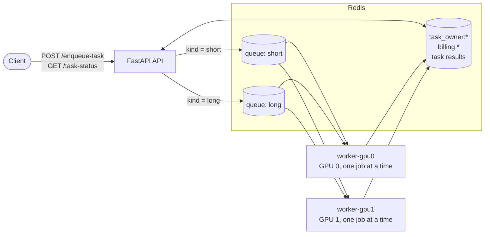

# micro-queue-starter

A small GPU job scheduler. A FastAPI service accepts jobs, Celery workers run
them with one worker per GPU, and Redis holds both the queues and the state
the API and workers share (task ownership, billing). The point is the
scheduling decisions rather than the jobs, which are stand-ins: one job per
card, a prefetch of 1 with late acks, and separate queues for short and long
work. It is written for engineers who look at backend and ML-infrastructure
code and want to see those decisions in a codebase small enough to read in
ten minutes.

## Quick start

```bash
git clone https://github.com/jctosta/micro-queue-starter
cd micro-queue-starter
docker compose --profile cpu up --build
```

The `cpu` profile starts Redis, the API on port 8000 and one worker. Without a
GPU the jobs sleep for their duration instead of running matrix
multiplications, so the queueing behaves the same on any machine. On a host
with two NVIDIA GPUs and the NVIDIA Container Toolkit, use
`docker compose --profile gpu up --build` to get one worker per card. Add
`--profile monitoring` to either command for Flower on http://localhost:5555.

API keys come from `fixtures/users.json`. In a second terminal:

```bash
# Submit a 2-second job to the short queue ("long" jobs may run up to 3000 s)
curl -s -X POST localhost:8000/enqueue-task \
  -H 'X-API-Key: default_api_key' -H 'Content-Type: application/json' \
  -d '{"kind": "short", "duration_s": 2}'
# {"task_id":"60f71e78-2f03-4a3d-8ff8-3558f7f9c9f7","status":"queued","result":null}

TASK=60f71e78-2f03-4a3d-8ff8-3558f7f9c9f7   # the task_id you got back

# Poll the status. Only the owner can see a task; any other key gets a 404.
curl -s localhost:8000/task-status/$TASK -H 'X-API-Key: default_api_key'
# {"task_id":"60f71e78-...","status":"SUCCESS","result":{"worker":"cpu@worker-cpu",
#  "gpu_id":null,"duration_s":2.0,"enqueued_at":1793843943.27,
#  "started_at":1793843943.32,"finished_at":1793843945.32}}

# Or stream it as server-sent events until it finishes
curl -sN localhost:8000/task-status/stream/$TASK -H 'X-API-Key: default_api_key'
# data: {"task_id":"60f71e78-...","status":"PENDING","result":null}
# data: {"task_id":"60f71e78-...","status":"SUCCESS","result":{...}}

# Every finished job is billed once to the user who submitted it
curl -s localhost:8000/billing-records -H 'X-API-Key: default_api_key'
# [{"user_id":"11111111-1111-1111-1111-111111111111","task_id":"60f71e78-...",
#   "cost":1.0,"description":"Short GPU job"}]

# Redis status and the number of jobs waiting in each queue (no key needed)
curl -s localhost:8000/health
# {"redis":"ok","queues":{"short":0,"long":0}}
```

## How it fits together



## Design notes

**One job per GPU.** In production, sharing a card between concurrent jobs
made every one of them slower. So a worker owns exactly one GPU and runs one
task at a time (`--concurrency=1`). `worker.py` takes its card from
`CUDA_VISIBLE_DEVICES` and refuses to start with more than one. In Compose,
each GPU worker reserves its own device, so a misbehaving job cannot touch
another card. Capacity grows by adding a worker per card, not threads per
worker.

**Prefetch 1 and late acks.** By default a Celery worker reserves several
messages ahead of the one it is running. With jobs that last minutes, that
means a short job can sit reserved behind a long one on a busy worker while
another worker is idle. `worker_prefetch_multiplier=1` makes a worker take only
the job it is about to run. `task_acks_late=True` acknowledges a job when it
finishes rather than when it starts, and `task_reject_on_worker_lost=True`
returns it to the queue if the worker process dies, so a crash does not lose
work. The price is at-least-once execution: a job can run twice if its worker
dies after finishing but before the ack. Billing is therefore idempotent per
task id (a `billed:{task_id}` marker written in the same Redis transaction as
the record). Durations are capped at 3000 s, below the Redis broker's one-hour
visibility timeout, after which an unacknowledged job would be handed to a
second worker while the first is still running it.

**Separate short and long queues.** Jobs that take seconds and jobs that take
minutes go to different queues (`task_routes` in `app/celery_app.py`). A
worker that consumes both takes from each in turn, because Kombu's Redis
transport rotates a worker's queues after every message. A burst of long jobs
therefore cannot put every short job behind it in one line. Taking turns is
fairness, not a latency guarantee: if every worker is busy with a long job, a
short one still waits. For a latency bound, dedicate a worker to the short
queue (`WORKER_QUEUES=short`); the load test below shows the difference. Short
jobs are capped at 60 s so a long job cannot be sent as "short" to pay less
and jump the line.

**Billing and ownership live in Redis.** The API and the workers are separate
processes, usually on separate machines, so anything both need cannot live in
either one's memory. Workers `RPUSH` each billing record as JSON to
`billing:{user_id}`; the API reads that list. On enqueue the API stores
`task_owner:{task_id}` (with the same TTL as Celery results) before publishing
the task, and both status endpoints answer 404 to anyone else, so task ids of
other users cannot be probed. Redis runs with an append-only file in Compose,
since it now holds billing data.

The code behind these notes is short:

| File | What to look at |
| --- | --- |
| `app/celery_app.py` | prefetch, late acks, queue routes |
| `worker.py` | one GPU and one job per worker |
| `app/store.py` | every Redis key, idempotent billing |
| `app/tasks.py` | the demo jobs and the timestamps they return |
| `main.py` | API endpoints, ownership check, SSE stream |
| `docker-compose.yml` | GPU reservations, profiles |

## Load test

`scripts/load.py` submits a seeded mix of jobs (by default 20 jobs: 90% short
at 5 s, 10% long at 90 s), waits for them, and reports throughput, queue wait
per queue and busy time per worker. Every figure comes from the timestamps
the jobs return: wait is `started_at - enqueued_at`, busy time is
`finished_at - started_at`.

Measured on an Apple M1 Max (macOS 27), with Docker Compose running under
Podman 5.7 in a Linux VM with 4 vCPUs and 7.4 GB of memory. The `cpu` profile
was used, so jobs sleep rather than use a GPU: the numbers show scheduling,
not compute.

**One worker consuming both queues** (`docker compose --profile cpu up`, then
`uv run scripts/load.py`):

```
20 jobs in 270.1 s, throughput 4.44 jobs/min

queue     jobs   wait p50 (s)   wait p95 (s)
short       18          222.5          260.8
long         2           52.5           95.2

worker                        jobs   busy (s)   busy %
cpu@worker-cpu                  20      270.1    100.0
```

Taking turns between queues, the worker ran short, long, short, long, then the
other 16 short jobs. The long jobs waited 5 s and 100 s, and 180 s of long
work landed in front of 16 of the 18 short jobs. With a single card nothing
else is possible: the worker was busy 100% of the run.

**Plus one worker dedicated to the short queue** (same stack, then
`docker compose --profile cpu run -d -e WORKER_QUEUES=short worker-cpu` and
`uv run scripts/load.py`):

```
20 jobs in 185.0 s, throughput 6.49 jobs/min

queue     jobs   wait p50 (s)   wait p95 (s)
short       18           37.5           75.8
long         2           50.0           90.5

worker                        jobs   busy (s)   busy %
cpu-short@worker-cpu            17       85.0     46.0
cpu@worker-cpu                   3      185.0    100.0
```

Short-job wait drops from 222.5 s to 37.5 s at p50 and from 260.8 s to 75.8 s
at p95. The second run has twice the workers, so part of that is capacity;
the per-worker split shows where it went. The dedicated worker ran 17 of the
18 short jobs, while the shared worker spent 180 s on the two long ones. What
wait remains is the burst itself: 18 short jobs arrive together and need 90 s
of work.

## Development

```bash
uv sync                               # add --extra torch for real GPU work
uv run ruff check .
uv run ruff format --check .
uv run mypy app main.py worker.py
uv run pytest -m "not integration"    # in-process, no Redis needed
```

The unit tests run tasks eagerly inside FastAPI's `TestClient`, with
`fakeredis` in place of Redis, and finish in under a second. The integration
tests talk to a live stack:

```bash
docker compose up -d redis
uv run worker.py      # in one terminal
uv run main.py        # in another
uv run pytest -m integration
```

CI (`.github/workflows/ci.yml`) runs both: the checks above on every push and
pull request, and the integration tests against a Redis service container.

## License

MIT. See [LICENSE](LICENSE).
